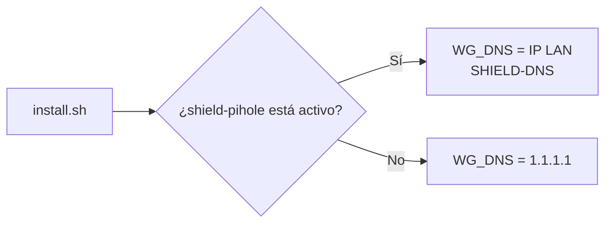

# Guía de desarrollo de HEIMDALL

Esta guía describe la arquitectura, la configuración y la validación para desarrollar o mantener HEIMDALL. La guía de uso está en [README.md](../README.md).

## Estructura

```text
HEIMDALL/
├── .claude/                 # Agentes y skills para Claude Code
├── .github/workflows/       # CI y GitHub Pages
├── docs/img/                # Imágenes del README y la web
├── site/                    # Web estática, única salida de Pages
├── docker-compose.yml       # wg-easy, Caddy y DuckDNS opcional
├── Caddyfile                # Proxy HTTPS
├── install.sh               # Instalación idempotente
├── update.sh backup.sh restore.sh uninstall.sh
└── .env.example             # Plantilla de configuración
```

## Configuración

| Variable | Descripción | Aplicación |
|---|---|---|
| `TZ` | Zona horaria | Compose |
| `WG_ADMIN_USER` | Usuario del panel | Solo primer arranque |
| `WG_ADMIN_PASSWORD` | Contraseña inicial | Solo primer arranque |
| `WG_HOST` | Dominio o IP pública para clientes | Solo primer arranque |
| `WG_PORT` | Puerto UDP de WireGuard, por defecto `51820` | Solo primer arranque |
| `WG_DNS` | DNS de los clientes | Solo primer arranque |
| `WEB_PORT` | Panel HTTPS, por defecto `51843` | Compose |
| `LAN_IP` | IP LAN de la máquina | Caddy y panel |
| `PI_HOSTNAME` | Nombre local de la máquina | Caddy |
| `DUCKDNS_SUBDOMAIN` | Subdominio DuckDNS | Perfil `ddns` |
| `DUCKDNS_TOKEN` | Token DuckDNS | Perfil `ddns` |

Las variables `INIT_*` del Compose solo se leen al crear los datos de wg-easy. Los cambios posteriores se hacen desde el panel o `docker compose exec -it wg-easy cli`.

## Qué mueve el instalador

`install.sh` instala Docker si falta, comprueba el plugin Compose, intenta cargar WireGuard, crea `.env`, detecta `LAN_IP` y `PI_HOSTNAME`, genera la contraseña vacía, determina `WG_HOST`, elige SHIELD-DNS o `1.1.1.1`, crea `data/`, arranca los servicios y espera una respuesta del panel. Si hay subdominio y token DuckDNS activa el perfil `ddns`.

Es idempotente: solo rellena variables vacías y no reemplaza datos persistentes. Si ya existe `data/wireguard/`, los cambios de `WG_*` en `.env` no cambian la configuración inicial de wg-easy.

## Topología, puertos y contenedores

| Contenedor | Puerto | Publicación | Uso |
|---|---:|---|---|
| `heimdall-wg` | `51820/udp` | Host | Túnel WireGuard; se reenvía en el router |
| `heimdall-wg` | `51821/tcp` | Solo red Docker | Web/API para Caddy; no se publica en el host |
| `heimdall-caddy` | `51843/tcp` | Host/LAN | Panel HTTPS |
| `heimdall-duckdns` | - | Ninguna | DNS dinámico opcional, perfil `ddns` |

La red se llama `heimdall`. Caddy hace `reverse_proxy wg-easy:51821`. `default_sni {$LAN_IP}` permite el acceso por IP y `tls internal` crea certificados internos. Las cabeceras son `nosniff`, `X-Frame-Options`, `Referrer-Policy` y `Permissions-Policy`; no hay CSP ni HSTS en Caddy. El `Caddyfile` va montado en el contenedor y Caddy no lo recarga solo: tras cambiarlo (o tras `./update.sh`), `docker compose restart caddy`.

## DNS de los dispositivos conectados



La decisión se toma al instalar y solo se conserva si `WG_DNS` estaba vacío. Después se modifica en el panel.

## Operación diaria avanzada

### Apagar la VPN un rato

```bash
docker compose --profile ddns down
./install.sh
```

El primer comando detiene también DuckDNS si está configurado; el segundo vuelve a levantar los servicios.

### Ver los registros

```bash
docker compose logs -f wg-easy
docker compose logs -f caddy
```

## Gotchas

- Editar `WG_ADMIN_PASSWORD` en `.env` no cambia la contraseña de una base de datos ya creada. Usa el panel o `docker compose exec -it wg-easy cli db:admin:reset`.
- `WG_HOST`, `WG_PORT` y `WG_DNS` iniciales no se aplican otra vez al repetir el instalador. Cambia el endpoint en el panel y regenera perfiles si cambia la dirección.
- El certificado de Caddy es interno; la advertencia del navegador es esperada.
- Si cambia la IP LAN, actualiza `LAN_IP` y reinicia el Compose; comprueba después el panel y el `default_sni`.
- DuckDNS es opcional y solo se activa cuando están definidas ambas variables del perfil.
- El reenvío de puertos requiere UDP `51820` y una IP LAN estable. CG-NAT no se arregla desde el código.

## Cambios comunes y dónde hacerlos

| Cambio | Lugar | Nota |
|---|---|---|
| Puerto VPN | `.env.example` / `.env`, `WG_PORT` | Requiere ajustar el router y perfiles |
| Puerto del panel | `.env`, `WEB_PORT` | TCP, solo LAN |
| DNS de clientes | Panel, Administración | No editar `.env` tras el primer arranque |
| Usuario o contraseña | Panel; inicialización en `.env` | Reset por CLI si se pierde |
| DuckDNS | `.env`, `DUCKDNS_*` | Reejecutar `./install.sh` para activar el perfil |
| Hostname | Detección de `install.sh` | Reejecutar si cambia |
| IP LAN | `.env`, `LAN_IP` | Debe coincidir con la máquina y Caddy |

## Lo que NO hacer

- No commitear `.env`, `data/`, claves, QR ni perfiles.
- No tocar `data/wireguard/` para cambiar una opción inicial sin entender que se perderían clientes.
- No cambiar `INIT_*` después de crear clientes esperando que el panel se actualice.
- No publicar `51821`; Caddy debe ser el único acceso web.
- No abrir `51843` en internet.
- No ejecutar scripts de gestión o Docker sobre producción sin autorización.
- No usar el perfil `ddns` sin configurar sus variables.

## Testing

La API de wg-easy v15 la usa ARIA; para pruebas manuales usa el panel o la CLI `docker compose exec -it wg-easy cli`. No se documentan llamadas con credenciales en la línea de comandos.

Validación local:

```bash
bash -n *.sh site/*.sh
shellcheck *.sh site/*.sh
cp .env.example /tmp/heimdall.env
sed -i -e 's/^WG_ADMIN_PASSWORD=.*/WG_ADMIN_PASSWORD=solo-para-ci/' -e 's/^WG_HOST=.*/WG_HOST=vpn.example.com/' -e 's/^LAN_IP=.*/LAN_IP=192.168.1.50/' -e 's/^PI_HOSTNAME=.*/PI_HOSTNAME=raspberrypi/' /tmp/heimdall.env
docker compose --env-file /tmp/heimdall.env config -q
docker compose --env-file /tmp/heimdall.env --profile ddns config -q
gitleaks git . --redact
```

Caddy se valida con un binario instalado o en un contenedor `caddy:2-alpine`, pasando `LAN_IP`, `WEB_PORT` y `PI_HOSTNAME`. No se debe ejecutar Docker sobre la máquina de producción solo para validar.

La CI real tiene estos jobs:

- `scripts`: `bash -n` y ShellCheck para scripts raíz y `site/`.
- `compose`: crea un `.env` ficticio, ejecuta Compose con y sin `ddns`, comprueba que solo se publican `51820/udp` y `51843/tcp`, y ejecuta `caddy validate` en `caddy:2-alpine` con `LAN_IP`, `WEB_PORT` y `PI_HOSTNAME`.
- `gitleaks`: descarga el binario oficial 8.30.1, verifica su suma y revisa historial y árbol.
- `web`: ejecuta `site/construir.sh`, comprueba CSP, ausencia de inline JS/CSS y `innerHTML`, enlaces existentes y JavaScript válido.

Pages ejecuta `site/construir.sh`, sube `_site` con `upload-pages-artifact` y publica con `deploy-pages`. Se dispara en `push` a `main` que toque `site/`, `docs/img/` o el workflow, y manualmente. Publica solo la web de `site/`, no la documentación Markdown.

## Vista previa de la web

```bash
site/construir.sh /tmp/heimdall-web/HEIMDALL
python3 -m http.server 8000 -d /tmp/heimdall-web
```

## Referencias

- [wg-easy](https://github.com/wg-easy/wg-easy)
- [WireGuard](https://www.wireguard.com/)
- [Caddy](https://caddyserver.com/docs/)
- [DuckDNS](https://www.duckdns.org/)
- [Docker Networking](https://docs.docker.com/network/)
